# AgentLedger SDK 🛡️⛓️

**Runtime kill switch, audit trail, and policy enforcement for AI agents. Add it in 3 lines.**

[](https://opensource.org/licenses/MIT)
[](https://www.npmjs.com/package/@ai-agent-ledger/sdk)
[](https://www.typescriptlang.org/)
[](https://www.npmjs.com/package/@ai-agent-ledger/sdk)

---

<p align="center">
  
</p>

---

## Install

```bash
npm install @ai-agent-ledger/sdk
```

```typescript
import { AgentLedger, POLICY_TEMPLATES } from '@ai-agent-ledger/sdk'

const ledger = new AgentLedger({ agent_id: 'my-agent', storage: { type: 'file', path: './audit.ndjson' }, policies: [POLICY_TEMPLATES.no_spend_over(500)] })
const agent = ledger.wrap(myExistingAgent) // every tool call is now governed
```

---

## Why this exists

Here is the scenario that made this necessary:

An AI agent, running unsupervised in a payment workflow, queued 47 transactions totalling $230,000 — none of them authorized. By the time anyone caught it, 12 had already executed. There was no kill switch. No audit trail. No way to explain to a board what the agent had been doing, or why it could not be stopped.

This is the pattern we kept hearing across AI engineering teams trying to ship to production. The agent works. It passes every test. Then it hits a real environment, and there is nothing between it and your production systems.

We went looking for the middleware layer that should exist — something you drop in front of any agent framework that intercepts tool calls before they execute, enforces policies, writes a tamper-evident log, and gives you a kill switch you can trigger in under 50ms. It did not exist. So we built it.

AgentLedger is that layer. It wraps your agent's tools, evaluates policies synchronously before each call, appends every event to a SHA-256 hash chain you can verify later, and gives you a kill switch you can trigger in under 50ms from a dashboard API.

---

## Framework Integrations

### LangChain

```typescript
import { ChatOpenAI } from '@langchain/openai'
import { AgentLedger, POLICY_TEMPLATES } from '@ai-agent-ledger/sdk'

const ledger = new AgentLedger({
  agent_id: 'langchain-agent',
  storage: { type: 'file', path: './audit.ndjson' },
  policies: [POLICY_TEMPLATES.no_delete(), POLICY_TEMPLATES.no_spend_over(1000)]
})

// Wrap your tools before passing them to the agent
const rawTools = [sendEmailTool, queryDatabaseTool, createPaymentTool]
const agent = ledger.wrap({ id: 'langchain-agent', tools: rawTools })

// Now pass agent.tools to your LangChain executor as normal
// Every call is intercepted, risk-scored, and hash-chained
```

> Full example: [`examples/langchain_integration.ts`](./examples/langchain_integration.ts)

---

### Anthropic (Claude Tool Use)

```typescript
import Anthropic from '@anthropic-ai/sdk'
import { AgentLedger, POLICY_TEMPLATES, PolicyBlockError } from '@ai-agent-ledger/sdk'

const ledger = new AgentLedger({
  agent_id: 'claude-agent',
  storage: { type: 'memory' },
  policies: [POLICY_TEMPLATES.no_delete()]
})

const myTools = [{ name: 'query_db', description: 'Query the database', func: async (...args) => queryDb(...args) }]
const governed = ledger.wrap({ id: 'claude-agent', tools: myTools })

// Use governed.tools as your Anthropic tool handlers
```

> Full example: [`examples/anthropic_integration.ts`](./examples/anthropic_integration.ts)

---

### Raw OpenAI (Function Calling)

```typescript
import OpenAI from 'openai'
import { AgentLedger, POLICY_TEMPLATES } from '@ai-agent-ledger/sdk'

const ledger = new AgentLedger({
  agent_id: 'openai-agent',
  storage: { type: 'memory' },
  policies: [POLICY_TEMPLATES.no_spend_over(500)]
})

const myTools = [{ name: 'create_payment', description: 'Create a payment', func: async (...args) => processPayment(...args) }]
const governed = ledger.wrap({ id: 'openai-agent', tools: myTools })

// Call governed.tools[0].func() — it runs your policy check first, then the real function
```

> Full example: [`examples/openai_integration.ts`](./examples/openai_integration.ts)

---

### CrewAI / AutoGen / Custom Agents

Any object with a `tools` array works:

```typescript
const myAgent = {
  id: 'my-crew-agent',
  tools: [
    { name: 'send_report', description: 'Send a report email', func: async (...args) => sendEmail(...args) },
    { name: 'write_file',  description: 'Write to disk',       func: async (...args) => writeFile(...args) }
  ]
}

const governed = ledger.wrap(myAgent)
// governed.tools[*].func is now intercepted — policies run, entries are logged
```

---

## Key Features

*   **🛡️ Policy Enforcement:** Block or gate tool calls with deterministic rules — no LLM in the enforcement path.
*   **🧠 Natural-Language Policies:** Write policies in plain English; compiled once at startup (Claude, Gemini, OpenAI, Groq, …) into a deterministic rule AST.
*   **⛓️ Tamper-Evident Ledger:** Every event is SHA-256 hash-chained. Edits, deletions, and reordering all break verification.
*   **🛑 Kill Switch:** Call `ledger.killSwitch(run_id)` — the next tool invocation for that run throws immediately.
*   **🔍 Risk Scoring:** Heuristic 0–100 scoring on tool names, arguments (PII/credential patterns), and payload size.
*   **🧵 Request-Scoped Runs:** `ledger.run(cb, run_id)` uses `AsyncLocalStorage` to isolate audit context across concurrent async requests.
*   **🤖 Framework Agnostic:** Works with LangChain, CrewAI, Anthropic, OpenAI, MCP servers (via the gateway), or any custom agent.

---

## Built-in Policy Templates

```typescript
POLICY_TEMPLATES.no_spend_over(500)              // Block any payment tool where amount > $500
POLICY_TEMPLATES.no_delete()                     // Block tools matching deletion patterns
POLICY_TEMPLATES.external_email_gate('corp.com') // Require approval before emailing outside domain
POLICY_TEMPLATES.business_hours_only(9, 17)      // Block all tool calls outside 09:00–17:00 UTC
POLICY_TEMPLATES.pii_write_alert(['#sec-ops'])   // Alert channel when PII detected in DB writes
```

---

## Approval Gates

```typescript
import { PolicyBlockError, ApprovalDeniedError } from '@ai-agent-ledger/sdk'

try {
  await governed.tools[0].func({ to: 'vendor@external.com', body: '...' })
} catch (err) {
  if (err instanceof PolicyBlockError) {
    // Blocked outright — check err.policy_id for which rule fired
  }
  if (err instanceof ApprovalDeniedError) {
    // A human reviewed and denied the approval gate
  }
}

// In your approval handler (e.g. from a dashboard or Slack webhook):
await ledger.approveGate(token, 'alice@corp.com')
// or
await ledger.denyGate(token, 'alice@corp.com')
```

---

## Kill Switch

```typescript
// Halt a specific run
await ledger.killSwitch('run-abc-123')

// Global halt — stops all future tool calls across all runs
await ledger.killSwitch()
```

---

## Audit Dashboard

```typescript
import { createDashboardServer } from '@ai-agent-ledger/sdk/server'

const server = createDashboardServer(ledger)
await server.listen({ port: 4000 })

// REST API:
// GET  /runs/:run_id          — list all entries for a run
// GET  /runs/:run_id/verify   — re-compute SHA-256 chain, returns { valid, broken_at }
// POST /runs/:run_id/kill     — kill switch via HTTP
// GET  /export/:run_id        — download audit log as JSON or plain text
// WebSocket /                 — live stream of entry, kill, and escalation events
```

---

## 🧠 Natural-Language Policies

Write policies in plain English. They compile **once at startup** into a deterministic rule AST — zero LLM calls on the enforcement path, so runtime evaluation stays synchronous and sub-2ms.

```typescript
import { AgentLedger, ClaudeCompiler, createGroqCompiler } from '@ai-agent-ledger/sdk'

const ledger = new AgentLedger({ agent_id: 'my-agent', storage: { type: 'memory' } })

// Pick any provider: ClaudeCompiler, GeminiCompiler, createOpenAICompiler,
// createGroqCompiler, createMistralCompiler, createDeepSeekCompiler, ...
const compiler = new ClaudeCompiler({ apiKey: process.env.ANTHROPIC_API_KEY! })

await ledger.policy.addPolicyAsync(
  {
    description: 'Never allow sending emails to addresses ending in @competitor.com',
    action: 'block',
    severity: 'high',
  },
  compiler
)
// From here on, enforcement is pure JS — the LLM is never called again.
```

Supported compile-time providers: **Anthropic (Claude), Google (Gemini), OpenAI, Groq, Mistral, xAI, Together, DeepSeek, Fireworks, Azure OpenAI** — plus any OpenAI-compatible endpoint via `ChatCompletionsCompiler`.

> Full example: [`examples/policy_compilation.ts`](./examples/policy_compilation.ts)

---

## Verify the Chain

Every entry's `id` is a SHA-256 over the entry *including* its `prev_id`, and verification checks both per-entry integrity **and** link continuity — so editing, deleting, reordering, or truncating entries is detected:

```typescript
import { verifyChain } from '@ai-agent-ledger/sdk'

const entries = await ledger.storage.query({ run_id: 'run-abc' })
const result = verifyChain(entries)
// { valid: false, broken_at: 3, reason: 'link_broken', runs: [...] }
// reason: 'hash_mismatch' → a field was edited
//         'link_broken'   → an entry was deleted/reordered mid-run
//         'bad_genesis'   → the start of the run was truncated
```

---

<!--
  Star History — bring this section back once the repo has ~200+ stars with visible momentum.
  Below that threshold an empty chart actively hurts perception. Just uncomment when ready.

  ## Star History

  [](https://star-history.com/#Esammy/AgentLedgerSDK&Date)

  ---
-->

## Project Structure

```
src/
  ledger/           — AgentLedger core, SHA-256 chain, run context (AsyncLocalStorage)
  interceptor/      — Tool wrapping, policy evaluation, kill switch, approval gates
  policy/           — PolicyEngine, rule evaluator, built-in templates
  policy/compilers/ — Natural language → rule AST (Claude, Gemini, OpenAI-compatible)
  risk/             — Heuristic risk scorer and PII/credential classifier
  storage/          — Pluggable adapters: File (NDJSON), Memory, Cloud WebSocket
  server/           — Lightweight Node http + WebSocket dashboard server
examples/
  basic_usage.ts            — Quickstart: block + allow
  policy_compilation.ts     — Natural-language policy → compiled rule
  concurrency_and_runs.ts   — Request-scoped run isolation
  langchain_integration.ts  — LangChain tool wrapping
  anthropic_integration.ts  — Anthropic Claude tool use
  openai_integration.ts     — Raw OpenAI function calling
```

> **S3 storage** requires the separate `@ai-agent-ledger/s3` package.

---

## Contributing

See [CONTRIBUTING.md](./CONTRIBUTING.md) for local setup, test commands, and how to propose new policy templates.

## License

MIT © [AgentLedger](https://github.com/Esammy/AgentLedgerSDK)
